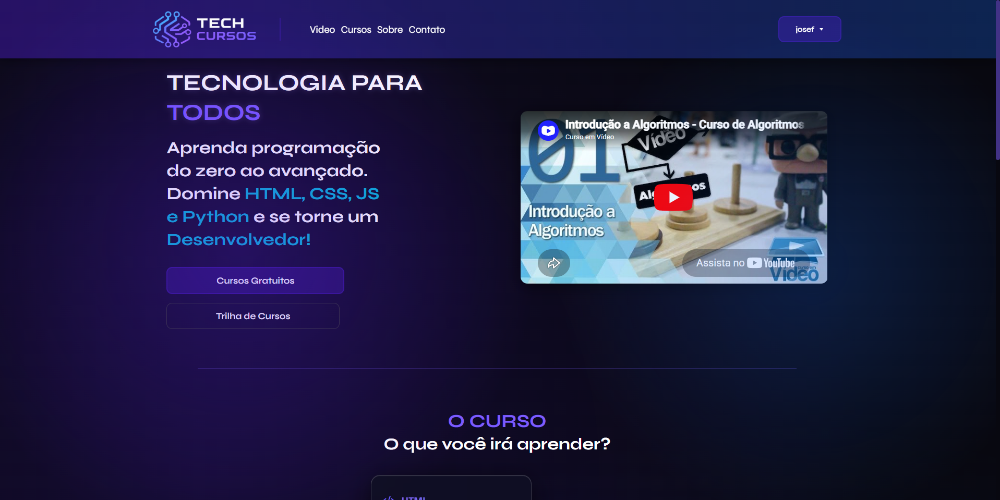

# Projeto Faculdade

Site acadêmico desenvolvido no primeiro semestre de Análise e Desenvolvimento de Sistemas na UNISUAM. O projeto usa HTML, CSS e JavaScript para apresentar um catálogo de cursos e praticar a navegação entre páginas, layouts responsivos e validação de formulários.

[Abrir o site no GitHub Pages](https://herbertfariasss.github.io/Projeto-Faculdade/)



## Como executar

```bash
git clone https://github.com/herbertfariasss/Projeto-Faculdade.git
cd Projeto-Faculdade
python -m http.server 8000
```

Abra [localhost:8000](http://localhost:8000) no navegador. Para explorar o fluxo de cadastro, use dados e uma senha fictícios. O login é uma demonstração e usa o armazenamento local do navegador. A consulta de CEP usa o ViaCEP e requer conexão com a internet.

## Estrutura do projeto

| Caminho | Conteúdo |
| --- | --- |
| [`index.html`](index.html) | Página inicial com apresentação, cursos, sobre e contato |
| [`cursos/`](cursos/) | Catálogo e páginas de aulas de HTML, CSS, JavaScript e Python |
| [`inscricao/`](inscricao/) | Telas de login, cadastro e perfil, com validação de CPF e consulta de CEP |
| [`css/`](css/) | Estilos da página inicial, dos cards e da navegação responsiva |
| [`js/script.js`](js/script.js) | Rolagem suave entre seções |
